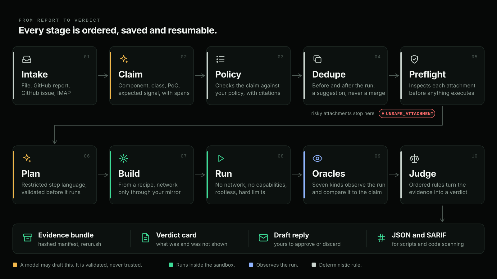
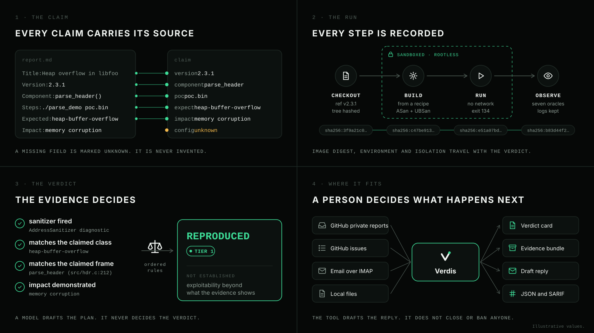
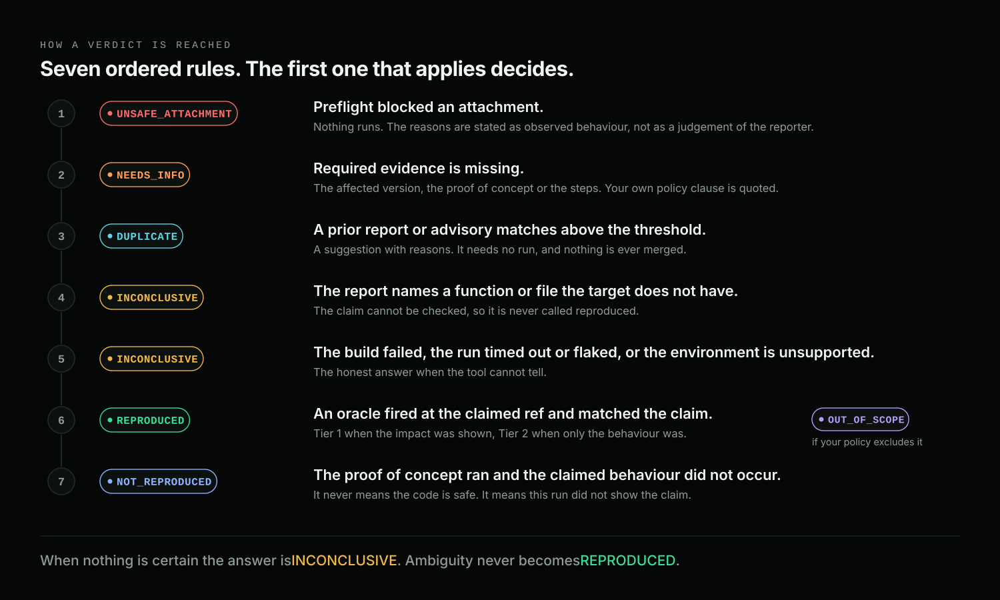
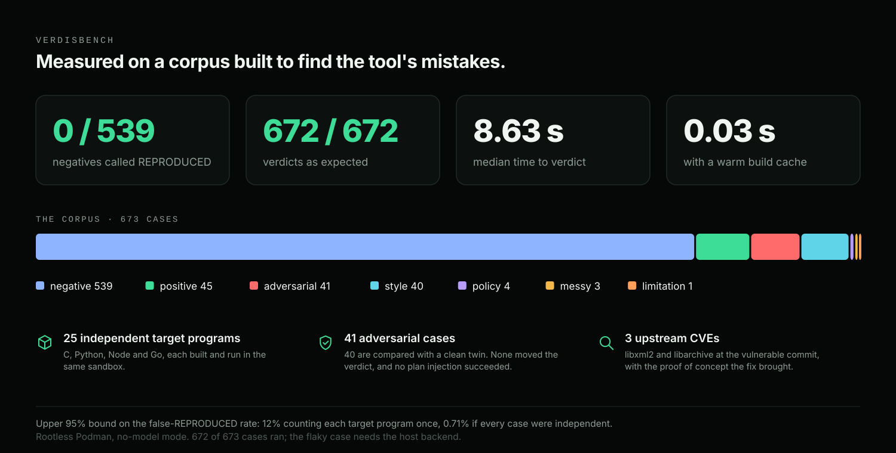

<div align="center">

<picture>
  <source media="(prefers-color-scheme: dark)" srcset="docs/assets/verdis-banner.svg">
  <source media="(prefers-color-scheme: light)" srcset="docs/assets/verdis-banner-light.svg">
  
</picture>

<h3>Reports are claims. Verdis runs them.</h3>

<p><i>Every verdict traceable to a run · every rule written down and tested · no model decides an outcome</i></p>

<p>
<a href="https://github.com/usualdork/verdis/releases/latest"></a>
<a href="https://github.com/usualdork/verdis/actions/workflows/ci.yml"></a>
<a href="LICENSE"></a>
<a href="#the-seven-verdicts"></a>
<a href="#what-the-benchmark-shows"></a>
<a href="#validate-the-repository"></a>
</p>

<p>
<a href="docs/guides/quickstart.md"></a>
<a href="docs/index.md"></a>
<a href="#install"></a>
</p>

**[Quickstart](docs/guides/quickstart.md)**  ·  **[How it works](docs/concepts/how-it-works.md)**  ·  **[The verdicts](docs/concepts/verdicts.md)**  ·  **[The benchmark](docs/reference/benchmark.md)**  ·  **[Threat model](docs/reference/threat-model.md)**

</div>

---

## Triage starts with its most expensive question

**Verdis** is an open-source tool that reproduces a security report before a human reads it. It builds your project at the claimed version, runs the proof of concept in a rootless sandbox with no network, and returns a verdict together with a hashed evidence bundle. It ships as a Python CLI and a GitHub Action.

A maintainer who opens a report needs five answers before anything can be decided. The first, *does this reproduce?*, takes the longest, and every answer that comes before it is a guess. Verdis answers all five in one pass, starting with that one.

<div align="center">

|  | Question | What Verdis does |
| :--: | --- | --- |
| **01** | Does it reproduce? | Builds the project at the claimed ref and runs the proof of concept in a sandbox with no network |
| **02** | Is it the bug the report describes? | Oracles compare what happened with the claim, and the reasoning is shown when they disagree |
| **03** | Is it in scope? | Reads your project's own policy and cites the clause that applies |
| **04** | Have we seen it before? | Two-pass dedupe against the local store and published advisories |
| **05** | Is the proof of concept safe to run? | Inspects attachments statically, quarantines risky ones, and executes only inside the sandbox |

</div>

<div align="center">



<sub><b>A real run.</b> The report and target are in <code>examples/demo</code>.</sub>

</div>

---

## Start here

<table>
<tr>
<td width="33%" valign="top">

### Run it

Install it, point it at a report and a checkout, then read the verdict card and the evidence bundle.

**[The quickstart](docs/guides/quickstart.md)**

</td>
<td width="33%" valign="top">

### Understand it

How a verdict is reached, what each of the seven verdicts means, and what the oracles do and do not establish.

**[How it works](docs/concepts/how-it-works.md)** · **[The verdicts](docs/concepts/verdicts.md)**

</td>
<td width="33%" valign="top">

### Adopt it

Write a policy for your project, add a build recipe, and run in shadow mode on your own reports before Verdis says anything to a reporter.

**[Policy](docs/guides/policy.md)** · **[Recipes](docs/guides/recipes.md)** · **[The Action](docs/guides/action.md)**

</td>
</tr>
</table>

---

## Install

```bash
pipx install verdis
verdis doctor
```

To try what is on `main` before it is released:

```bash
pipx install "verdis @ git+https://github.com/usualdork/verdis"
```

Or from a checkout:

```bash
git clone https://github.com/usualdork/verdis.git
cd verdis && pip install .
verdis doctor
```

`doctor` checks the sandbox backend, the images and the permissions.

Verdis needs **Python 3.12+** and **Podman or Docker**. A proof of concept is attacker-controlled code, so when no container runtime is available Verdis stops instead of running it on the host. The host-process backend (`--sandbox local`) exists for development, is not a security boundary, and has to be requested by name.

Pull the sandbox image once. It is built for linux/amd64; on Apple Silicon, `make sandbox` builds it for your machine instead:

```bash
docker pull ghcr.io/usualdork/verdis/base:latest   # or: podman pull
```

Images are never pulled at run time: the bits that run are the ones you pinned. If your runtime is a VM or a remote daemon, point it at a directory it can mount:

```bash
export VERDIS_WORK_DIR=~/.cache/verdis
```

---

## One triage

```bash
verdis triage report.md --repo ./libfoo --ref v2.3.1
```

```
Verdis verdict: REPRODUCED (Tier 1)   report VDS-0042   target libfoo@v2.3.1

Why: the sanitizer oracle fired and matched the claim; the claimed impact
     (memory corruption) was demonstrated
Evidence:
  1. run 1: AddressSanitizer reported a diagnostic
  2. run 1: sanitizer class heap-buffer-overflow
  3. run 1: frame #1 parse_header (src/hdr.c:212)
Policy:
- SECURITY.md Supported versions: version 2.3.1 matches supported pattern 2.x
Duplicates: none above threshold.
Suggested next action: confirm the severity and decide on a fix
Bundle: ~/.local/share/verdis/evidence/reports/VDS-0042/bundle  (run ./rerun.sh to reproduce)
Not established: exploitability beyond what the evidence shows; behaviour on
configurations other than the one tested.
```

The card states what was shown and what was not. A reproduction is evidence about one claim at one ref in one configuration; severity, exploitability and the reply to the reporter stay with you.

Useful flags: `--compare <ref>` checks whether a fix removes the behaviour, `--output json|sarif` feeds scripts and code scanning, `--bundle-out <path>` writes the evidence bundle where you want it, and `--model-provider none|openai|anthropic|ollama` selects the model, or none.

---

## How it works

<div align="center">



</div>

<table>
<tr>
<td width="50%" valign="top">

**The model drafts. The sandbox runs.** A language model can read the prose of a report and draft a run plan. It never decides whether a bug reproduced, and it never sees the inside of the sandbox.

</td>
<td width="50%" valign="top">

**Oracles decide.** Sanitizer output, crashes, uncaught exceptions, canary files, differential runs, property scripts and expected output are compared with the claim. A crash in an unrelated function does not confirm a report.

</td>
</tr>
<tr>
<td width="50%" valign="top">

**Every verdict carries its proof.** The bundle holds the run, the environment, the image digest and the isolation that was used, so a verdict can be re-checked instead of taken on trust.

</td>
<td width="50%" valign="top">

**A person decides what happens next.** Verdis drafts the reply and leaves the decision to the maintainer. In the Action's comment or label mode it posts a comment or applies the label you chose, and nothing is ever closed, rejected or banned.

</td>
</tr>
</table>

<div align="center">



</div>

---

## The seven verdicts

<div align="center">

| Verdict | Meaning |
| --- | --- |
| `REPRODUCED` | An oracle fired at the claimed ref and matches the claim. **Tier 1**: the impact was demonstrated. **Tier 2**: the behaviour was demonstrated and the impact was not. |
| `NOT_REPRODUCED` | The build and the proof of concept ran, and the claimed behaviour did not occur. |
| `INCONCLUSIVE` | The build failed, the run timed out, the result was flaky, or the environment could not answer. This is the default under doubt. |
| `OUT_OF_SCOPE` | It reproduces, and your policy excludes it. The clause is cited with its file, heading and lines. |
| `DUPLICATE` | It matches a prior report or published advisory above the threshold. A suggestion, never a merge. |
| `NEEDS_INFO` | Required evidence is missing. The policy clause is quoted and a checklist is drafted. |
| `UNSAFE_ATTACHMENT` | Preflight quarantined the attachment. Observations are stated as behaviour, not as a judgement of the reporter. |

</div>

The rules run in a fixed order and the first one that applies decides. They are written in [`src/verdis/judge/rules.py`](src/verdis/judge/rules.py) and explained in [the verdicts page](docs/concepts/verdicts.md).

<div align="center">



</div>

---

## What you get

| Capability | How it is delivered |
| --- | --- |
| A reproducible triage pipeline | Intake, claim extraction, policy check, dedupe, attachment preflight, plan, build, run, oracles, judgement, evidence |
| Four intake sources | Local files, GitHub private reports, GitHub issues and IMAP |
| Builds for four ecosystems | C and C++ with ASan and UBSan, Go with the race detector, Node and Python, plus a Dockerfile mode |
| Seven oracle types | Crash, sanitizer, exception, canary, differential, property and output |
| A cited project policy | `.verdis/policy.yml`, with hints derived from `SECURITY.md` and `THREAT_MODEL.md` when it is absent |
| Two-pass dedupe | Against the local store and against published advisories, with a threshold you set |
| Attachment preflight | Static inspection and quarantine, with an optional REA plugin for native binaries |
| A model-free path | Reports that carry an [RRS block](docs/concepts/rrs.md) are triaged with no model at all, at zero cost |
| Evidence bundles | A hashed manifest, a `rerun.sh`, and `verdis bundle verify` |
| A GitHub Action | Shadow, comment and label modes, with the token kept out of the sandbox |
| Plugins at the edges | Intake sources, model providers, sandboxes, oracles and emitters register through entry points |

---

## The evidence bundle

Every verdict ships with a bundle: the report as it arrived, the claim, the plan, the policy matches, the build and run logs, the oracle results, the environment, the verdict in JSON and Markdown, a draft reply, and a script that reproduces the run on another machine.

```
bundle/
├── manifest.json          versions, hashes, the environment
├── original/report.md     the report as it arrived, unmodified
├── claim.json             what was understood, with source spans
├── plan.json · plan.txt   the plan, in full and in readable form
├── policy_matches.json    the clauses that matched, with citations
├── build.json · build.log
├── run.json · run.log     every run, with exit codes and timings
├── oracles.json           what each oracle saw, and whether it matched
├── fs_changes.json        files the run created or changed
├── blocked_network.json   outbound attempts the sandbox refused
├── environment.json       image digests, kernel, tool versions
├── verdict.json · verdict.md
├── draft_reply.md         a reply you can approve, edit or discard
└── rerun.sh               reproduces the run elsewhere
```

```bash
verdis bundle verify bundles/VDS-0042/   # re-hash every file against the manifest
cd bundles/VDS-0042 && ./rerun.sh        # run it again, next to the original
```

A bundle holds no secrets, because the orchestrator's tokens never enter a sandbox, and no exploit material beyond the reporter's own proof of concept.

---

## What the benchmark shows

<div align="center">



</div>

VerdisBench is a corpus of 673 cases from 25 independent target programs written in C, Python, Node and Go. Each case is a report, a target and a statement of what the verdict should be, and each program is checked in a real container before a case is written from it. The corpus includes 41 adversarial reports that try to steer the tool, 40 of them compared against a clean twin, and three upstream CVEs (libxml2 and libarchive) taken at the vulnerable commit with the proof of concept the fix brought.

Because the 539 negatives share 25 programs, the cases are not independent draws, and the upper 95% bound on the false-`REPRODUCED` rate is **12%** when each program counts once. It is 0.71% if every case were independent. Both figures, with the reasoning, are in [the benchmark reference](docs/reference/benchmark.md). The corpus found nine real defects while it was being built, and each one is now a regression test.

```bash
make corpus && make corpus-check   # build the cases, prove each program behaves as claimed
make benchmark-sandbox             # run the whole corpus inside a container
```

---

## Validate the repository

```sh
git clone https://github.com/usualdork/verdis.git
cd verdis
python3 -m venv .venv && source .venv/bin/activate
python3 -m pip install -e ".[dev]"
pytest
```

CI holds the core to 100% line coverage. The suite includes a sandbox conformance run that asserts the isolation is really there: no network, no writes outside the work directory, no privilege gain, and resource overruns stopped. It runs against a real container runtime in CI on every push.

---

## The security model

Everything in a report is treated as hostile input, including the text a model reads and the commands a plan proposes.

<div align="center">

| Layer | What applies |
| --- | --- |
| Runtime | Rootless Podman or Docker, a non-root user, user namespaces on |
| Privileges | All capabilities dropped, `no-new-privileges`, the default seccomp profile, no devices |
| Network | None in the run stage. The build stage may reach a mirror you configure, and nothing else |
| Filesystem | The source is mounted read-only, with no other host mounts |
| Limits | CPU, memory, processes, disk, open files and wall-clock time, with the process group killed on timeout |
| Secrets | The orchestrator's tokens never enter a sandbox, and the environment is scrubbed to the plan's own variables |
| Plan language | A restricted step language. A shell command string, a path that leaves the work directory, or a program off the allowlist is refused before anything runs |

</div>

No sandbox is perfect. Run Verdis on a dedicated, ephemeral runner that holds no other secrets, and start in shadow mode. The full model, including what is out of scope, is in the [threat model](docs/reference/threat-model.md).

---

## Scope

Verdis is built for maintainers triaging reports about **their own projects**. It reproduces the report it is given. It does not find vulnerabilities, audit a codebase, or create, improve or weaponise a proof of concept, and it does not score or detect the authorship of reporters: it judges evidence, not people. A `REPRODUCED` verdict is evidence about one claim, at one ref, in one configuration, and it is not a statement about a project's security as a whole.

## Status

<div align="center">

| Area | State | Notes |
| --- | :--: | --- |
| Triage pipeline, CLI and evidence bundles | Alpha | Every verdict as expected across the 673-case corpus |
| Container sandbox (rootless Podman, Docker) | Alpha | Conformance suite green on Podman and Docker (macOS) and on Docker (Linux CI). No independent review yet |
| GitHub Action | Alpha | Begin in `shadow` mode |
| Model-assisted claim extraction and planning | Experimental | The benchmark runs model-free, so this path has no measured accuracy yet |
| Observation integrity | Known gap | Oracles read what the sandboxed process prints, so a proof of concept can print a convincing diagnostic. Read the matched output in the card, and run `--compare` against the fixed ref. The [threat model](docs/reference/threat-model.md#10-forged-observations) has the detail |
| Upstream CVE corpus | Growing | 3 admitted, 40 planned |
| Maintainer pilots | Planned | No published case studies yet |

</div>

---

## The Reproducible Report Spec

A small YAML block a reporter can add to a report. Reports that carry one are triaged without a model and deduplicate reliably. `verdis preflight` checks a proof of concept in a clean environment and writes the block for you.

```yaml
rrs: 0.1
target:
  repo: https://github.com/example/libfoo
  ref: v2.3.1
claim:
  class: CWE-122
  component: src/hdr.c:parse_header
  impact: memory corruption leading to crash
steps:
  - build: default
  - run: ./build/parse_demo poc.bin
inputs:
  - path: poc.bin
    sha256: <hash>
expect:
  oracle: sanitizer
  signature: heap-buffer-overflow in parse_header
config:
  default: true
```

The specification is in [the concepts page](docs/concepts/rrs.md).

## The GitHub Action

```yaml
- uses: usualdork/verdis@v1
  with:
    mode: shadow
    sandbox: default
  env:
    GITHUB_TOKEN: ${{ secrets.GITHUB_TOKEN }}
```

It runs as a composite action, so the proof of concept runs in the runner's own container runtime. It asks for the minimum permissions and passes the token only to the step that posts a comment or applies a label, after the verdict exists. Run it in `shadow` mode for a month before you let it comment.

---

## Documentation

<div align="center">

| | |
| --- | --- |
| **Concepts** | [How it works](docs/concepts/how-it-works.md) · [Verdicts](docs/concepts/verdicts.md) · [The plan language](docs/concepts/plan-language.md) · [RRS](docs/concepts/rrs.md) |
| **Guides** | [Quickstart](docs/guides/quickstart.md) · [Policy](docs/guides/policy.md) · [Recipes](docs/guides/recipes.md) · [Plugins](docs/guides/plugins.md) · [The Action](docs/guides/action.md) |
| **Reference** | [CLI](docs/reference/cli.md) · [Configuration](docs/reference/configuration.md) · [Bundles](docs/reference/bundles.md) · [Benchmark](docs/reference/benchmark.md) · [Threat model](docs/reference/threat-model.md) · [Schemas](docs/reference/schemas.md) |

</div>

---

## Project leadership

<table>
<tr>
<td valign="middle">

**Manish Tripathy** — Maintainer

</td>
<td valign="middle">

<a href="https://github.com/usualdork"></a>
<a href="https://github.com/usualdork/verdis/blob/main/.github/SECURITY.md"></a>

</td>
</tr>
</table>

## Contributing

Read [CONTRIBUTING.md](CONTRIBUTING.md), the [Code of Conduct](CODE_OF_CONDUCT.md) and the [security policy](.github/SECURITY.md) before opening an issue.

Issues, corrections, recipes, oracles and adapters are welcome. Verdis gets better when people who maintain software tell us what their reports look like, and the benchmark gets better when they send the cases that break it.

Use synthetic, consented, anonymised or non-sensitive public examples. Do not submit personal data, live-case material, victim information, target lists, credentials or harmful operational detail.

## License

Copyright © 2026 the Verdis contributors.

Licensed under the [Apache License 2.0](LICENSE). Contributions are accepted under the same licence.

---

<div align="center">
<br>
<sub>Verdis reproduces reports. It does not find, write or improve exploits.<br>
Every verdict is a statement about evidence, and every decision stays with a person.</sub>
</div>
