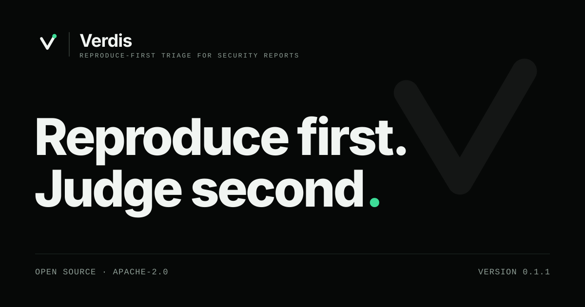

# Verdis

<p align="center">
<picture>
  <source media="(prefers-color-scheme: dark)" srcset="assets/verdis-banner.svg">
  <source media="(prefers-color-scheme: light)" srcset="assets/verdis-banner-light.svg">
  
</picture>
</p>

**Don't read the report until it has been reproduced.**

Verdis is an open-source tool that tries to reproduce a security report
before a human reads it. It extracts the claim, checks it against the
project's own security policy, checks for duplicates, inspects attachments
for danger, builds the project at the claimed version, runs the proof of
concept in an isolated sandbox with no network, and hands the maintainer a
verdict with evidence.

> An LLM proposes, the sandbox disposes. Models read prose and draft run
> plans. Whether a bug reproduced is decided by observable oracles —
> sanitizer output, crashes, canary files, differential runs — never by a
> model's opinion.

**Maintainers make every final decision.** Verdis never closes,
rejects, labels invalid or bans a report on its own.

## Install

```bash
pipx install verdis
```

## Use it

```bash
verdis triage report.md --repo ./libfoo --ref v2.3.1
```

## What comes back

```
Verdis verdict: REPRODUCED (Tier 1)   report VDS-0042   target libfoo@v2.3.1

Why:
     the sanitizer oracle fired and matched the claim; the claimed impact
     (memory corruption) was demonstrated
Evidence:
  1. run 1: AddressSanitizer reported a diagnostic
  2. run 1: sanitizer class heap-buffer-overflow
  3. run 1: frame #1 parse_header (src/hdr.c:212)
Policy:
- SECURITY.md Supported versions: version 2.3.1 matches supported pattern 2.x
Duplicates: none above threshold.
Suggested next action: confirm the severity and decide on a fix
Bundle: bundles/VDS-0042/  (run ./rerun.sh to reproduce)
Not established: exploitability beyond what the evidence shows; behaviour on
configurations other than the one tested.
```

## The ten principles

1. **Evidence over opinion.** Every verdict links to artifacts a human can
   inspect. "Reproduced" requires an oracle to fire, never a model's
   judgement.
2. **An LLM proposes, the sandbox disposes.** Models read prose and draft
   plans. They never decide outcomes and never execute commands outside
   the sandbox.
3. **Humans decide.** Advisory by default. When you enable the GitHub
   Action's comment or label mode, the most it does is post a comment or
   apply the label you chose. It never closes, rejects or bans anything.
4. **Everything from the report is hostile.** Text, attachments and PoCs
   are attacker-controlled input to the tool itself.
5. **No network, no secrets** in the run stage.
6. **Fair to reporters.** Failure messages say what was tried and how to
   fix the report. The tool judges reports, not people.
7. **Private by default.** Nothing leaves the host unless configured.
   Embargoed reports stay embargoed.
8. **Boring and reproducible.** Deterministic pipeline, pinned images,
   hashes. Same inputs, same verdict.
9. **Small core, plugins at the edges.** Build recipes, oracles, sandboxes
   and platform adapters are plugins.
10. **Honest about limits.** Hardware, cloud-specific and timing-race
    bugs return `INCONCLUSIVE`, not a guess.

## Intended use

Maintainers triaging reports about **their own projects**. Verdis
reproduces reports; it does not find, write, improve or weaponise
exploits. It has no AI-authorship detection and never scores reporters:
it judges evidence, not people.
